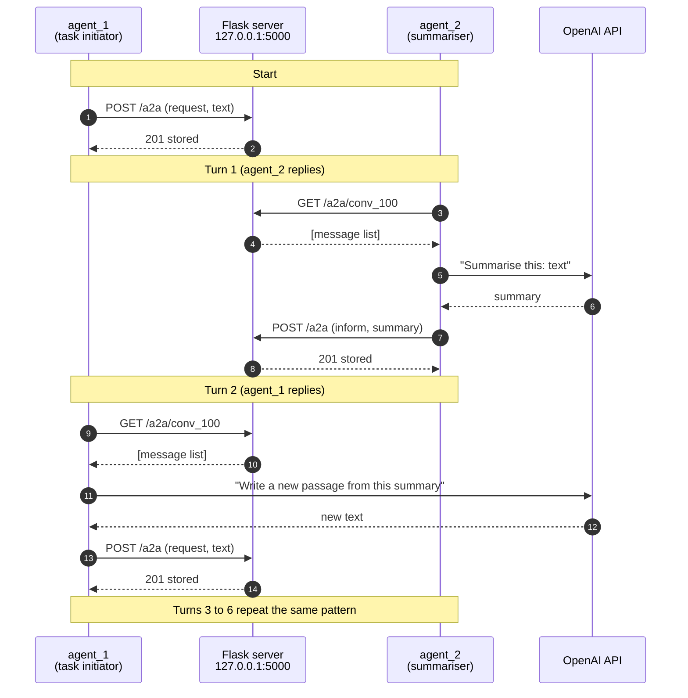
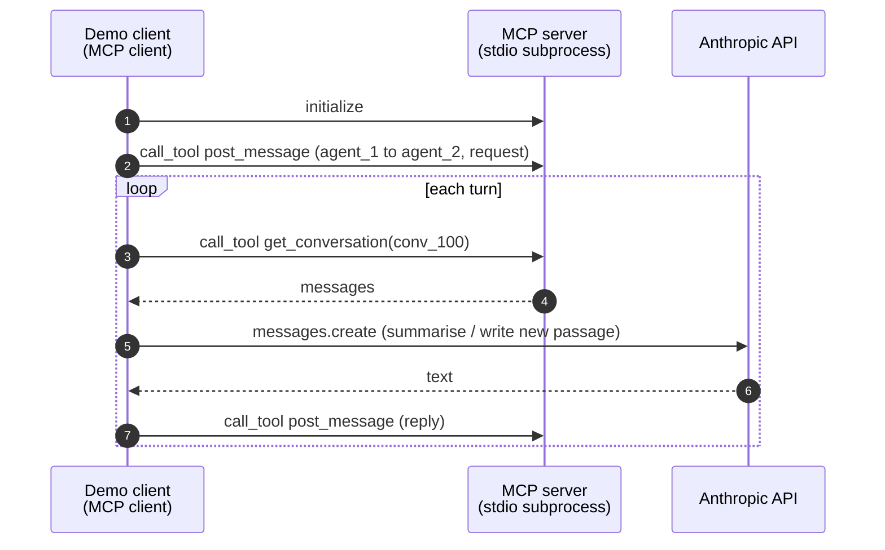

# Comparing A2A-Type of Agent-to-Agent Communication with MCP

## Agent-to-Agent (A2A-style) Communication

A small demo of an agent-to-agent (A2A-style) communication loop. A Flask REST server stores
messages; two OpenAI-backed agents take turns reading the latest message and replying:

- **agent_2** summarises the text it receives (`performative: inform`).
- **agent_1** writes a new passage based on that summary (`performative: request`).

Inspired by a teaching exercise notebook by Harriet Farlow (from the book "Practical AI Security", No Starch Press, 2026) for building an agent-to-agent (A2A-like) communication loop (the notebook itself is not included in this repository).

### Protocol

| Endpoint | Purpose |
|---|---|
| `POST /a2a` | Submit a message. Requires `performative`, `sender`, `receiver`, `ontology`, `conversation_id`, `content`; otherwise `400`. Returns `201`. |
| `GET /a2a/<conversation_id>` | List all messages of a conversation, in order. |

Messages are held in memory only (lost when the server stops).

### Message flow

The agents never talk to each other directly; each only talks to the server, which acts as a
shared mailbox. Every turn: GET the thread, read the last message (its `receiver` decides which
agent acts), call OpenAI, POST the reply with sender and receiver swapped.



### Setup

```powershell
python -m venv .venv
.venv\Scripts\Activate.ps1
pip install -r requirements.txt
pip install -e .
copy .env.example .env      # then edit .env and add your key
```

Get an API key at <https://platform.openai.com/account/api-keys> (billing must be set up).

#### API key safety

- The key lives only in `.env` (or your OS environment as `OPENAI_API_KEY`).
- `.env` is listed in `.gitignore`; only `.env.example` (placeholder) is committed.
- Never paste the key into code, notebooks or commits. If it leaks, revoke it in the OpenAI dashboard.

### Run

```powershell
python -m agentcomms --turns 6 --delay 1
```

Options: `--port`, `--turns`, `--delay`, `--conversation-id`. The server binds to `127.0.0.1`
only. To expose it publicly (the notebook used ngrok) run `ngrok http 5000` yourself; note the
server has no authentication, so don't leave it exposed.

## MCP variant (Anthropic Claude)

A comparable version where the mailbox is an **MCP server** instead of a REST server, and the agents
are driven by **Claude** instead of OpenAI. Same prompts, same message format, same turn logic.

```powershell
# add ANTHROPIC_API_KEY to .env first (see .env.example)
python -m agentcomms.run_demo_mcp --turns 6 --delay 1
```

The client launches `agentcomms.mcp_server` as a stdio subprocess (no port is opened) and calls two tools.



## REST vs MCP at a glance

| | REST / A2A-style (`python -m agentcomms`) | MCP (`python -m agentcomms.run_demo_mcp`) |
|---|---|---|
| Mailbox | Flask server, HTTP on `127.0.0.1:5000` | MCP server, stdio subprocess |
| Write / read | `POST /a2a`, `GET /a2a/<id>` | tools `post_message`, `get_conversation` |
| Validation | Hand-written required-field check, `400` | Tool input schema derived from the function signature |
| Discovery | None; client must know the URLs | `tools/list` returns names, descriptions, JSON schemas |
| Network exposure | Open port (unauthenticated) | None with stdio |
| Who can call it | Any HTTP client | Any MCP client, including an LLM that picks tools itself |
| LLM | OpenAI `gpt-4o-mini` | Claude, set via `ANTHROPIC_MODEL` in `.env` (falls back to `claude-opus-5-5` if unset; the demo here was run with `claude-haiku-5-5`) |
| Orchestration | Python loop | Python loop (same, for a like-for-like comparison) |

Note the two variants differ in both transport and LLM, so output differences mix both effects.
The Claude calls enable the server-side refusal fallback (beta) by default; costs and behaviour are
described in the Anthropic docs.

## Test

```powershell
pytest
```

Tests mock OpenAI, so no key or network is needed.

## Layout

```
src/agentcomms/   server.py (Flask), agents.py (OpenAI agents), config.py (key loading), run_demo.py
                  mcp_server.py (MCP mailbox), agents_claude.py (Claude agents), run_demo_mcp.py
tests/            pytest suite
```
