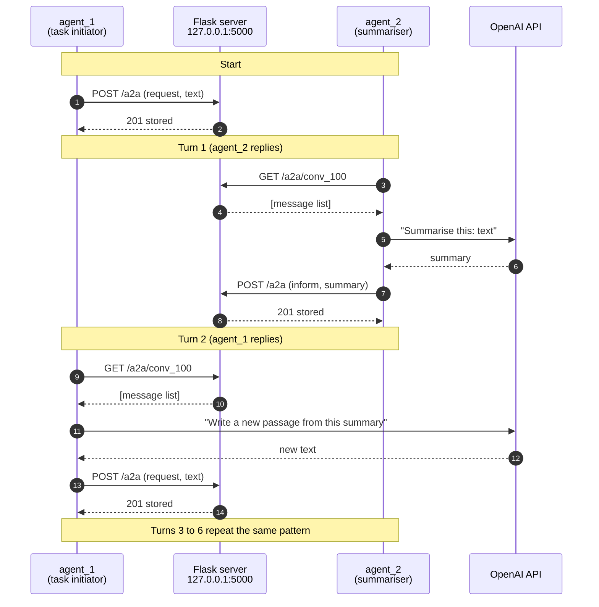

# agentcomms

A small demo of an agent-to-agent (A2A-style) communication loop. A Flask REST server stores
messages; two OpenAI-backed agents take turns reading the latest message and replying:

- **agent_2** summarises the text it receives (`performative: inform`).
- **agent_1** writes a new passage based on that summary (`performative: request`).

Derived from the exercise in [`docs/agentcomms.ipynb`](docs/agentcomms.ipynb).

## Protocol

| Endpoint | Purpose |
|---|---|
| `POST /a2a` | Submit a message. Requires `performative`, `sender`, `receiver`, `ontology`, `conversation_id`, `content`; otherwise `400`. Returns `201`. |
| `GET /a2a/<conversation_id>` | List all messages of a conversation, in order. |

Messages are held in memory only (lost when the server stops).

## Message flow

The agents never talk to each other directly; each only talks to the server, which acts as a
shared mailbox. Every turn: GET the thread, read the last message (its `receiver` decides which
agent acts), call OpenAI, POST the reply with sender and receiver swapped.



## Setup

```powershell
python -m venv .venv
.venv\Scripts\Activate.ps1
pip install -r requirements.txt
pip install -e .
copy .env.example .env      # then edit .env and add your key
```

Get an API key at <https://platform.openai.com/account/api-keys> (billing must be set up).

### API key safety

- The key lives only in `.env` (or your OS environment as `OPENAI_API_KEY`).
- `.env` is listed in `.gitignore`; only `.env.example` (placeholder) is committed.
- Never paste the key into code, notebooks or commits. If it leaks, revoke it in the OpenAI dashboard.

## Run

```powershell
python -m agentcomms --turns 6 --delay 1
```

Options: `--port`, `--turns`, `--delay`, `--conversation-id`. The server binds to `127.0.0.1`
only. To expose it publicly (the notebook used ngrok) run `ngrok http 5000` yourself; note the
server has no authentication, so don't leave it exposed.

## Test

```powershell
pytest
```

Tests mock OpenAI, so no key or network is needed.

## Layout

```
src/agentcomms/   server.py (Flask), agents.py (LLM agents), config.py (key loading), run_demo.py
tests/            pytest suite
docs/             original notebook
```
